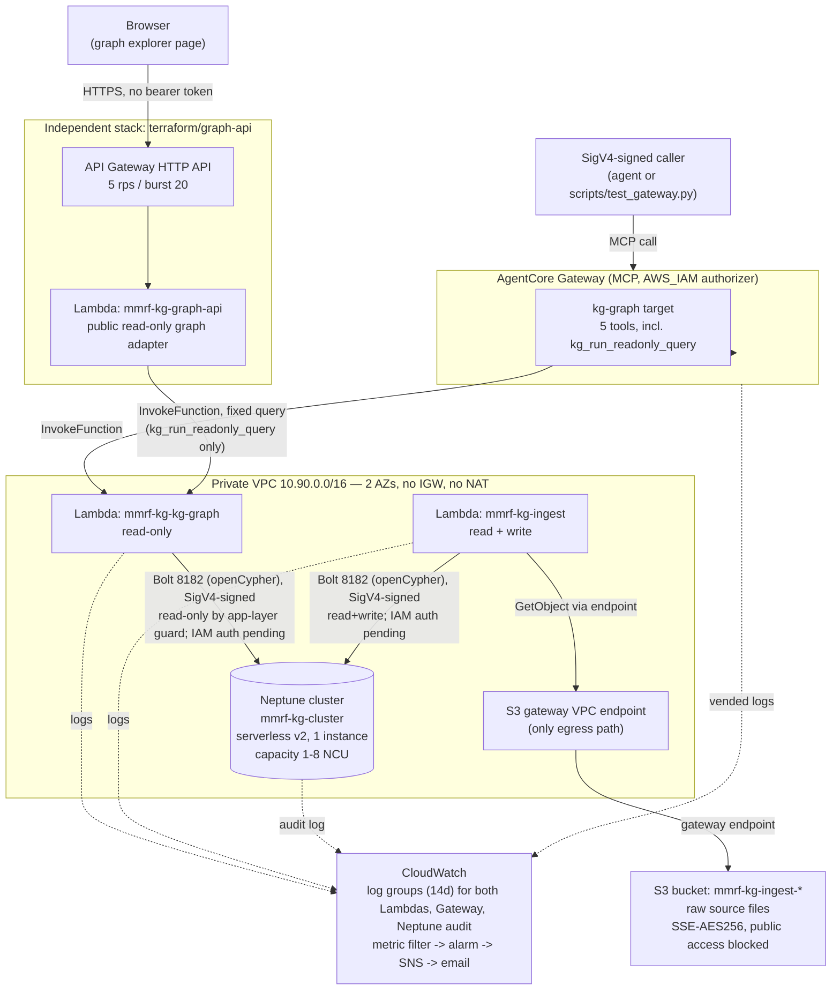

# Workstream 1 architecture

Replaces the earlier build-plan diagram for this workstream (it drew the full combined ORION
system in a shared sandbox account in `us-east-1`; see "What changed" below). Scope here is only
what this repository owns and deploys: the knowledge graph, its Gateway, and the graph explorer.
Workstream 2 (orchestrator, Virtual Lab) is a separate repository and out of scope.

Every box below is a resource in `terraform/` or `terraform/graph-api/`, verified against that
code on 2026-11-04, not reconstructed from memory or the old diagram. For why each technology
was chosen, and the alternatives considered, see
[docs/technology-choices.md](technology-choices.md).

## Components, as deployed, and their scaling limits

| Component | Terraform | Current scaling behavior | Known open limit |
|---|---|---|---|
| Neptune cluster (`mmrf-kg-cluster`) | `main.tf` | Serverless v2, compute auto-scales 1–8 NCUs with load | Single instance, no reader, `skip_final_snapshot = true` — an instance/AZ fault is a full outage with no recovery path (well-architected-review.md, Reliability) |
| `kg-graph` Lambda | `loader_lambda.tf` | Stateless; Lambda scales concurrency automatically per request | No reserved/provisioned concurrency set; cold starts happen in-VPC; nothing upstream bounds concurrent calls (see Gateway row). `tracing_config.mode = "Active"` is set, but the VPC has no NAT/IGW and no X-Ray interface endpoint, so X-Ray segments from inside the VPC have no path out and are silently dropped — basic Lambda logs still work, since those go through the Lambda service plane, not this VPC's routing |
| `kg-ingest` Lambda | `ingest.tf` | Scales fine as a function, but each invocation does one full load | Writes one node/edge per round trip with no batching or backoff; fine at ~50 nodes, a known blocker at 15x data volume (Open Targets + CIViC) per well-architected-review.md. Same X-Ray gap as `kg-graph` above |
| AgentCore Gateway | `gateway.tf` | Exposes 5 tools over MCP, `AWS_IAM` authorizer | No WAF, no request throttling, no per-tool scoping — any caller holding `bedrock-agentcore:InvokeGateway` can call all 5 tools including the open-ended `kg_run_readonly_query`, bounded only by that tool's own row/hop caps |
| S3 ingest bucket | `ingest.tf` | S3 scales inherently; reached only through the free S3 gateway VPC endpoint (no NAT) | None at this data size |
| Graph API (`graph-api/main.tf`) | `terraform/graph-api` | Independent stack; its own Lambda scales with Lambda concurrency | HTTP API stage is deliberately throttled to 5 rps / burst 20 for the sandbox; every request still funnels through the single `kg-graph` Lambda it invokes. The dependency is a hardcoded function-name default (`var.graph_function_name = "mmrf-kg-kg-graph"`) resolved via `data "aws_lambda_function"`, not remote state — destroying the parent stack leaves this stack with a dangling reference instead of a Terraform-visible error |
| CloudWatch alarms/SNS | `alarms.tf` | Managed service, scales without action | Alarms cover Lambda crashes/timeouts and query errors, not an idle-but-running Neptune cluster or a Gateway-level failure |

`kg_run_readonly_query` itself caps output at 100 rows and 5 hops but not intermediate
cardinality, so a 5-hop pattern over a much larger graph can still be expensive before that cap
applies (well-architected-review.md, Performance Efficiency).

These are the same gaps already tracked as open items in
[docs/well-architected-review.md](well-architected-review.md); this page describes current
behavior, it does not change it.

## What changed from the old diagram

The previous diagram (a build-plan page, not checked into this repo) showed the combined
Workstream 1 + Workstream 2 system in one AWS sandbox account in `us-east-1`. Compared against
the Terraform actually deployed here:

- Workstream 1 runs in **its own VPC**, not the shared sandbox account, and in **`us-west-2`**,
  not `us-east-1` — AD-003 and AD-005 both record this as a correction made on 2026-11-04.
- The old diagram had no Graph API / explorer box; it didn't exist yet. It's now a third,
  independent Terraform root that only invokes the existing read-only Lambda.
  See [docs/graph-api.md](graph-api.md).
- The old diagram had no observability box. `alarms.tf` (metric filter, two Lambda-error alarms,
  SNS topic) and the Neptune audit log group did not exist when it was drawn.
- Workstream 2 (orchestrator agent, Gateway target for Virtual Lab tools, CloudFront frontend) is
  intentionally omitted here: it is not part of this repository, so it can't be verified from
  this codebase. See AD-003 and AD-005 for its design as last documented there.
