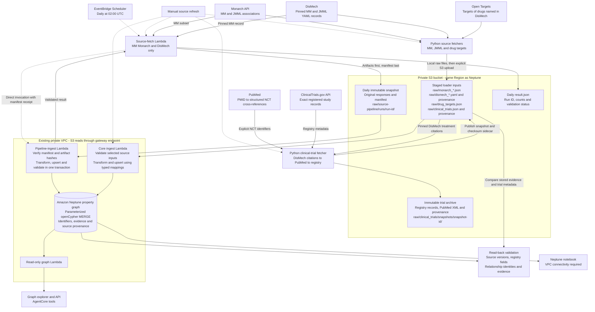

# ORION ingestion pipeline

This diagram describes the implemented AWS ingestion paths in `us-west-2`.
All paths use bounded public source records and the existing private S3 bucket
and Neptune cluster. Solid arrows carry data; dashed arrows trigger processing.

The **daily path** refreshes only the Multiple Myeloma Monarch/DisMech subset.
The fetch Lambda invokes ingestion directly; no Step Functions workflow or S3
event notification is involved. The manifest commits a complete snapshot, and
`result.json` records the validation result. A delivery acknowledgement alone
does not establish ingestion success.

The **manual path** stages MM/JMML records and optional drug targets, then
explicitly invokes `mmrf-kg-ingest`. Clinical trials use the same loader with
`clinical_trials: true`. Their fetcher reads the staged DisMech records, resolves
only structured PubMed registry accessions, archives the original responses,
and publishes a checksummed snapshot. Registry records remain a separate source
from DisMech biological evidence. Trial refresh is currently manual.

The **graph writes** are small incremental upserts into an existing graph.
Daily refreshes validate relationship counts within the transaction and read
them back after commit. Manual loads report graph counts; the dedicated
validation scripts compare complete treatment evidence and trial metadata
against S3. Repeated loads merge existing identifiers and do not automatically
delete records removed upstream. Larger initial datasets should use Neptune's
bulk loader; that is a separate path from this incremental implementation.

Raw source records stay in private S3. Original IDs, source versions, citation
references, retrieval timestamps and checksums identify where data came from.
The explorer displays metadata and source links; it omits article quotations.

Run and deployment details:

- [Daily source pipeline](source-pipeline.md).
- [Complete DisMech treatment evidence](dismech-treatment-evidence.md).
- [Clinical-trial fetch, ingestion and validation](clinical-trials.md).
- [Graph API and explorer](graph-api.md).
