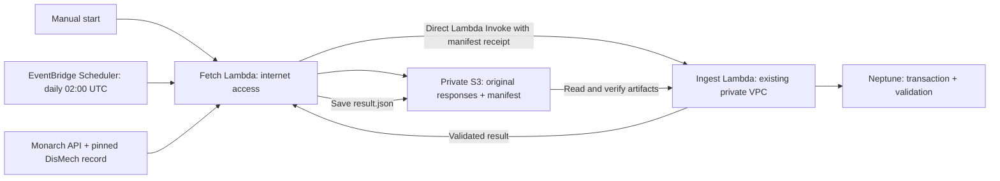

# Source → S3 → Neptune

The fetch Lambda downloads the bounded Multiple Myeloma records from Monarch
and one pinned DisMech YAML, commits an S3 manifest, then directly invokes the
private ingestion Lambda to upsert and validate that exact snapshot in Neptune.



EventBridge Scheduler invokes the fetch Lambda directly once daily at **02:00 UTC**
(`cron(0 2 * * ? *)`), with no flexible delivery window. No Step Functions workflow
or S3 notification is involved. Scheduled occurrences give retries a stable run ID,
and each day creates a fresh snapshot. The fetch Lambda runs
outside the VPC and writes S3 results, so no extra private VPC write permissions
or endpoints are needed.

## Daily schedule

The schedule is `mmrf-kg-source-pipeline-daily` in the `default` schedule group in
`us-west-2`. Its execution role can invoke only the source-fetch Lambda. Change
`daily_schedule_hour_utc` (0-23) to use another daily UTC hour. The schedule follows
UTC throughout the year; a local-time equivalent changes with daylight saving.

The payload includes the schedule ARN and scheduled occurrence time in `id`.
The existing handler converts this to a deterministic UUID. Scheduler delivery
retries and Lambda asynchronous retries reuse the same snapshot/result instead
of creating a new run. The next scheduled occurrence gets a different UUID.
It deliberately does not use Scheduler's execution ID, which changes per attempt.
See [Scheduler context attributes](https://docs.aws.amazon.com/scheduler/latest/UserGuide/managing-schedule-context-attributes.html).

Scheduler retries failed delivery up to twice within one hour. A successful
delivery means Lambda accepted the event asynchronously, not that Neptune has
been updated. Function execution failures use Lambda's asynchronous retry
behavior. Check `result.json` in S3 and both Lambda log groups to confirm ingestion.
No dead-letter queue or notification channel is configured in this prototype.
See [scheduled Lambda invocation](https://docs.aws.amazon.com/lambda/latest/dg/with-eventbridge-scheduler.html).

Inspect the deployed schedule:

```sh
aws scheduler get-schedule --name mmrf-kg-source-pipeline-daily --group-name default \
  --profile mmrf-hackathon --region us-west-2
```

To pause daily runs, set `daily_schedule_enabled = false` in an ignored
`terraform/source-pipeline/terraform.tfvars`, review the plan in that root, and
apply it. Set it back to `true` to resume. Manual runs still work when paused.
Destroying this independent stack also removes the schedule and its execution role.

## Run the deployed pipeline

```sh
uv run python scripts/run_source_pipeline.py
```

This uses profile `mmrf-hackathon`, account `548574235556`, and region `us-west-2`.
It prints the run ID, waits for the direct Lambda response, verifies the saved S3
manifest/result, and prints validated counts. Add `--no-wait` to queue an
asynchronous invocation, then inspect `result.json` in S3 or Lambda logs.

To retry a failed run using its committed sources, or retrieve a completed result:

```sh
uv run python scripts/run_source_pipeline.py --run-id '<run UUID>'
```

A completed run returns its saved receipt without fetching sources or writing the
graph again. Use a new run ID (the default) to refresh the sources. If the caller
times out, retry the same run ID to confirm the outcome. Failure does not prove
that the graph transaction rolled back; the timeout may occur after commit.

The equivalent synchronous AWS CLI invocation is:

```sh
aws lambda invoke --function-name mmrf-kg-source-pipeline-fetch \
  --cli-binary-format raw-in-base64-out --payload '{"run_id":"<run UUID>"}' \
  --cli-read-timeout 910 --profile mmrf-hackathon --region us-west-2 /tmp/source-result.json
```

Check the Lambda response's `FunctionError` and the saved result's `status`.
Logs are in `/aws/lambda/mmrf-kg-source-pipeline-fetch` and
`/aws/lambda/mmrf-kg-source-pipeline-ingest`. Inspect the latest fetch logs with:

```sh
aws logs tail /aws/lambda/mmrf-kg-source-pipeline-fetch --since 30m \
  --profile mmrf-hackathon --region us-west-2
```

## What is stored

The existing bucket is `mmrf-kg-ingest-116383a80f025a64d381928e54`, in `us-west-2`.
New objects are confined to this independent prefix:

```text
raw/source-pipeline/runs/<run UUID>/
  artifacts/<attempt UUID>/
    monarch-version-before.json
    monarch-entity.json
    monarch-associations-000.json
    monarch-version-after.json
    monarch_mm.json
    dismech_mm.yaml
    dismech_mm.yaml.provenance.json
  manifest.json
  result.json
```

Original responses remain unchanged. `monarch_mm.json` is the compatible loader
input, retaining every original association field and its source version. The
manifest records each artifact's S3 key, SHA-256 checksum, byte count, request
URLs, source versions, retrieval timestamps, and source terms.

Artifacts are written with conditional create requests and SSE-S3 encryption.
The manifest is written last; no manifest means no ingestion. A retried download
uses a new attempt path and never overwrites partial artifacts. Replaying a
committed run reuses its manifest. Ingestion verifies the receipt, manifest, and
every artifact, including the original HTTP responses, before opening a graph
transaction. The result file records successful read-back validation and its
exact manifest hash. Invocation failures produce a `FAILED` result with an error
type and a warning that commit status may be uncertain; details are in Lambda logs.
A hard Lambda timeout or S3 outage can prevent result persistence, so also inspect
logs when no result exists. Retrying a failed run reuses its committed manifest.

The legacy `raw/monarch_mm.json` and other fixed-key objects are unchanged. The
existing ingestion Lambda, graph API, AgentCore tools, Neptune resources, and
network rules are not managed or updated by this stack.

## Loading and validation

This is a **small incremental refresh of an already loaded graph**. It reuses the
current `load_monarch` / `load_dismech` functions and their parameterized `MERGE`
statements, preserving the existing labels, identifiers, predicates and citation
semantics. It adds ingestion provenance on each refreshed edge:

- `ingestion_run_id`, `retrieved_at`, `source_url`
- `raw_s3_uri`, `raw_sha256`, `source_record_pointer`, original `source_record_id` when present
- `source_manifest_uri`, `source_manifest_sha256`, and complete `evidence_json`

All original fields, including confidence or review metadata, remain in the S3
source records. Missing confidence is not inferred. Existing tool behavior,
including its first-evidence-item summaries and limitations, stays the same.

Both sources and their provenance are written in one transaction. Expected
relationship identities are derived from the input records, then counts are
checked by source and version before commit and read back after commit. A mismatch
fails the task. The ingestion Lambda has concurrency 1, so pipeline writes and
validation cannot overlap. Avoid manually running the legacy ingestion Lambda
at the same time.

Retrying ingestion merges the same identities instead of adding duplicates.
Completed fetch runs return their saved results without invoking ingestion. This is
**upsert only**: records removed upstream are not deleted, and old-version graph
records may remain. Use `source_version` / `ingestion_run_id` to distinguish
refreshed records. A full replacement/reconciliation policy is deliberately not
part of this prototype.

Bounds: 100 Monarch associations, four association-page requests, 4 MiB per
artifact, and 300 graph relationships per refresh. Unsupported/negated records,
repeated graph identities, incomplete pagination, and source-version changes
fail before loading. Monarch descendants are included only when the original
record's ontology closure explicitly contains `MONDO:0009693`; relationships
retain their original subject/object and predicate.

For initial datasets or larger subsets, use Neptune-compatible node/edge CSVs in
S3 and the [Neptune bulk loader](https://docs.aws.amazon.com/neptune/latest/userguide/bulk-load.html).
This incremental workflow does not call the bulk loader or migrate the existing
graph's identifier scheme.

DisMech stays pinned to commit `b1ca0b232b815a21b4ba95a62828c9979e9a49e7`
(`v0.1.46`). Daily runs refresh that reviewed record, not silently
switch to `main`. Update the Terraform revision deliberately for an upgrade.
Only one record is fetched; no bulk DisMech or complete Monarch download occurs.
DisMech data terms remain unconfirmed for redistribution: keep the snapshots
private in the sandbox and see [data terms](data-terms.md). Neither source contains
patient/cohort data in this workflow.

## Deploy

```sh
uv run python scripts/build_source_pipeline.py
terraform -chdir=terraform/source-pipeline init
terraform -chdir=terraform/source-pipeline validate
terraform -chdir=terraform/source-pipeline plan -out=source-pipeline.tfplan
terraform -chdir=terraform/source-pipeline apply source-pipeline.tfplan
```

Use only this independent root. A fresh deployment adds two Lambdas, their roles/log
groups, permission for direct ingestion, and the daily Scheduler schedule with its
execution role/policy. Updating an already deployed direct-Lambda pipeline adds
only the schedule, its role, and its policy. It does not replace or edit the existing
bucket, graph, gateway, or networking. Preserve its ignored local Terraform state.
Source data, zip packages, plans, and state must not be committed.

When upgrading the earlier pipeline stack, the plan removes its old state machine,
workflow IAM policy, and workflow IAM role, then updates the two pipeline Lambdas
and fetch permissions. Confirm no execution is running before applying that
migration. Existing S3 snapshots and Neptune data remain in place. Do not apply
the parent `terraform/` stack for this change.

The build copies the existing loader and signed Neptune connection module into
the new ingestion package, using the core build script's dependency versions.
It never rebuilds or deploys the existing Lambda package. Rebuild these packages
when changing pipeline code or intentionally adopting a newer loader revision.

When using another sandbox, set `account_id`, `aws_profile`, `region`,
`existing_ingest_function`, and `neptune_cluster_resource_id`. Get the latter from
`aws neptune describe-db-clusters` → `DbClusterResourceId`; it is an immutable
cluster resource ID, not a hostname. The new write role is scoped to that cluster.
The existing function provides the bucket, endpoint, subnets and security groups.
Its S3 gateway endpoint must permit reads of this prefix in the same-region bucket.

## Test and demonstrate

```sh
uv run pytest
uv run ruff check source_pipeline scripts/build_source_pipeline.py scripts/run_source_pipeline.py tests/test_source_pipeline.py
uv run python scripts/run_source_pipeline.py
```

Tests cover manifest commit ordering, interrupted uploads/retries, corrupt files,
source-version changes, scope limits, validation failures before commit, direct
Lambda errors, retrying failed/completed runs with the same snapshot, and stable
run IDs across Scheduler retries with a fresh ID for each occurrence.
After the live run, open the graph explorer and select **Refresh**. Select a
relationship to see its source version and retrieval timestamp. Original records
and complete provenance are available through the result's manifest URI in S3.

## Teardown

```sh
terraform -chdir=terraform/source-pipeline plan -destroy -out=source-pipeline.tfplan
terraform -chdir=terraform/source-pipeline apply source-pipeline.tfplan
```

This removes the daily schedule and the two pipeline Lambdas, roles, policies, and logs. Source snapshots/results
in the existing bucket and data already merged into Neptune remain. Manage those
separately if deliberately cleaning up the sandbox.
