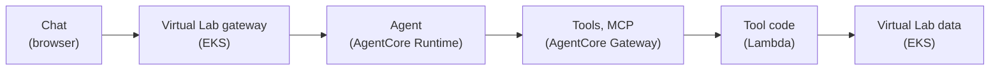

# Agent architecture

How the Virtual Lab chat agent is organised, today on Docker Compose and as
planned on AWS AgentCore. The AgentCore parts are a proposal and are not built
yet; see [Status](#build-and-deploy).

## Overview

| Step | Runs in | Does | Code lives in |
| --- | --- | --- | --- |
| Chat | Browser | User asks a question; draws the chart that comes back | Frontend fork `mmrf-data-commons` |
| Virtual Lab gateway | EKS | Passes the question to the agent | This repo |
| Agent | AgentCore Runtime | Plans, picks tools, writes the answer | This repo |
| Tools (MCP) | AgentCore Gateway | Lists the Virtual Lab tools for the agent | AWS managed; schemas from this repo |
| Tool code | Lambda | Our existing tool code, e.g. survival | This repo |
| Virtual Lab data | EKS | Gen3 Analysis, Guppy, ProteinPaint | Upstream repos, pinned |

## What's inside each step

- **Chat**: `src/features/chat/` in the frontend fork. An assistant-ui adapter
  calls the agent. Each tool has its own component in `src/features/chat/tools/`.
- **Virtual Lab gateway**: `identity/server.mjs`. Routes `/agent/v1/prompts` to
  the agent and adds the sandbox login to data calls.
- **Agent**: `agent/src/`, using the Strands TypeScript SDK and Amazon Bedrock.
  Holds the system prompt and chat history. The model sees only each tool's
  `summary`, never the chart data.
- **Tools (MCP)**: tool schemas come from `agent/src/tool-catalog.mjs`. The
  Gateway has one target, the Lambda.
- **Tool code**: `agent/src/executors/`, plus a new handler in `agent/lambda/`.
  Every tool returns `{summary, plot}`.
- **Virtual Lab data**: Gen3 Analysis, Guppy and ProteinPaint over 1,000
  synthetic cases.

## One question, step by step

Journey 1: "Compare overall survival for CGS high risk vs standard risk."

1. Chat sends `{prompt, history}` to `/agent/v1/prompts`.
2. The gateway forwards it to the agent.
3. The agent calls `correlation_plot("overall survival", "CGS risk")`. It adds
   the website's selected cohort itself, so the model can't change it.
4. AgentCore Gateway runs the tool in the Lambda. The tool code asks Gen3 for
   one survival curve per group (`POST /analysis/v0/survival/`).
5. The tool returns:
   - `summary` for the model: "High risk n=339, Standard risk n=661; log-rank p=7.1e-60."
   - `plot` for the screen: curves, counts and p-value.
6. The agent returns `{message, toolCalls}`. Chat draws the curves with the
   platform's existing `SurvivalPlot` chart and shows the text.

## Build and deploy

| Piece | Built from | Deployed by | Status |
| --- | --- | --- | --- |
| Chat | Frontend fork, commit pinned in `sources.json` | `frontend` image on EKS | Done |
| Virtual Lab gateway | `identity/` | `identity` image on EKS | Needs the call to Runtime |
| Agent | `agent/`, ARM64 image | ECR, then AgentCore Runtime | To do |
| Tools (MCP) | Schemas from `tool-catalog.mjs` | AgentCore Gateway | To do |
| Tool code | `agent/src/executors/` and `agent/lambda/` | Lambda (outside the VPC) | To do |
| Virtual Lab data | Upstream repos, pinned | EKS | Done |

- **AWS**: `python3 scripts/aws_sandbox.py deploy` deploys everything. The
  agent is not part of the AWS deployment yet, so Chat works only locally for
  now.
- **Local**: Docker Compose runs the agent and the tool code in one `agent`
  container. Put Bedrock settings in `agent/.env`; see
  [agent/README.md](../agent/README.md).

## AWS network and access

The sandbox's network stays as it is. Nothing new goes inside the VPC, and the
existing CloudFront URL and load balancer are reused.

Where each piece sits:

- **Internet**: the browser and CloudFront (the public HTTPS URL).
- **Sandbox VPC (unchanged)**:
  - The existing private load balancer (ALB), on HTTP port 80, which only
    CloudFront may connect to.
  - EKS nodes running `access` (team password check), `identity` (the
    gateway), and Gen3, Guppy and ProteinPaint. The nodes are in public
    subnets, so pods can reach AWS APIs.
- **AWS managed, outside the VPC (new)**: AgentCore Runtime (the agent),
  AgentCore Gateway (the tools), the tool-code Lambda and Bedrock (the model).

How each hop is allowed:

| Hop | How it connects | What allows it | Status |
| --- | --- | --- | --- |
| Browser → CloudFront → ALB | HTTPS, then CloudFront's private VPC origin | ALB security group admits only CloudFront; `access` checks the team password | Exists |
| ALB → `access` → `identity` → data | Inside the cluster | Kubernetes network policies; `identity` adds the sandbox token | Exists |
| `identity` → Runtime | AWS API call over the internet | The EKS node role is allowed to invoke the Runtime | New |
| Runtime → Bedrock | AWS internal | Runtime's IAM role, allowed to invoke the model | New |
| Runtime → Gateway | MCP over HTTPS | The simplest inbound auth the Gateway offers (to confirm) | New |
| Gateway → Lambda | AWS invoke, no network path | Gateway's IAM role, allowed to invoke the Lambda | New |
| Lambda → CloudFront → ALB → data | HTTPS to the public sandbox URL | Team password, as an encrypted Lambda environment variable | New |

### The final hop: Lambda to the data

1. The Lambda sends, for example, `POST https://<sandbox URL>/analysis/v0/survival/`
   with the team login as HTTP Basic auth in the `Authorization` header.
2. CloudFront passes it to the existing private ALB, which forwards to
   `access` on the EKS nodes (NodePort 30080).
3. `access` (`identity/access.mjs`) checks the team login, removes it, and
   passes the request to `identity`.
4. `identity` adds the sandbox token and routes by path: `/analysis/*` to Gen3
   Analysis, `/guppy/*` to Guppy, `/protein-paint/*` to ProteinPaint.
5. The response returns the same way.

The Lambda uses the same front door as a browser. In the tool code this is just
configuration: `VIRTUAL_LAB_ORIGIN` is the sandbox URL, and the `fetchImpl`
passed to the executors adds the `Authorization` header.

Where the Lambda's settings come from:

| Setting | Source | Set by |
| --- | --- | --- |
| `VIRTUAL_LAB_ORIGIN` | Terraform output `https_url` (the CloudFront URL) | `aws_sandbox.py deploy`, after `terraform apply` |
| `SANDBOX_ACCESS_USERNAME`, `SANDBOX_ACCESS_PASSWORD` | `generated/aws/access.json`, created once by `aws_sandbox.py` and also stored in the `sandbox-access` Kubernetes secret | `aws_sandbox.py deploy`, after it writes the secret |

Terraform creates the Lambda with placeholder values. The deploy script then
sets the real ones with `aws lambda update-function-configuration`. AWS
encrypts Lambda environment variables by default. The password is not passed
through Terraform, because it is generated after `terraform apply` and would
otherwise be stored in the Terraform state.

### Hackathon shortcuts

These keep the setup small. Revisit them before any production use.

- Data calls from the Lambda go out through the public sandbox URL rather than
  staying inside the VPC.
- The EKS node role, not a per-pod role, invokes the agent, so any pod on the
  nodes could call it.
- The team password is the Lambda's credential for the data.

The new resources go in two files, one per owner: `terraform/agentcore-runtime.tf`
(Runtime, its role, its image repository) and `terraform/agentcore-gateway.tf`
(Gateway, Lambda, their roles). Plans: [docs/plans/](plans/).

## Adding a tool

1. Write the executor in `agent/src/executors/`; it returns `{summary, plot}`.
2. Register its spec in `agent/src/tool-catalog.mjs` under its website app.
3. Add it to the Lambda handler in `agent/lambda/`. The Gateway schema is
   exported from the spec.
4. Add a component in the frontend fork's `src/features/chat/tools/`, keyed by
   the tool name.
5. Push the fork, update its commit in `sources.json`, and redeploy.

Tools today: `correlation_plot` (survival), `top_mutated_genes`,
`differential_expression`, `update_cohort`, `show_lollipop`, `show_survival`,
`show_oncomatrix` and `check_virtual_lab_health`. When
`KG_GATEWAY_URL` is set, Chat, the prompt API, and the tools catalog discover
knowledge graph tools through the gateway's MCP `tools/list` on each request.
Discovery follows pagination and uses the returned descriptions and input
schemas, so tool additions or schema changes need no app code changes. Only
tools from the `kg-graph` target are registered; `kg_run_readonly_query` remains
excluded. Tools must return the existing knowledge graph envelope with a
nonempty `summary`. Discovery failures fail the request rather than falling
back to a stale list. The system prompt keeps the evidence and synthetic-data
rules; tool selection guidance comes from the discovered descriptions.
The local Virtual Lab analysis tools remain registered in the application.

## To check before building the AWS parts

- AgentCore availability in the sandbox account's region.
- Terraform support for AgentCore Runtime and Gateway.
- How the Runtime agent authenticates to the Gateway.
- Payload size limits (a survival `plot` is about 150 KB).
- MCP client support in the Strands TypeScript SDK.
